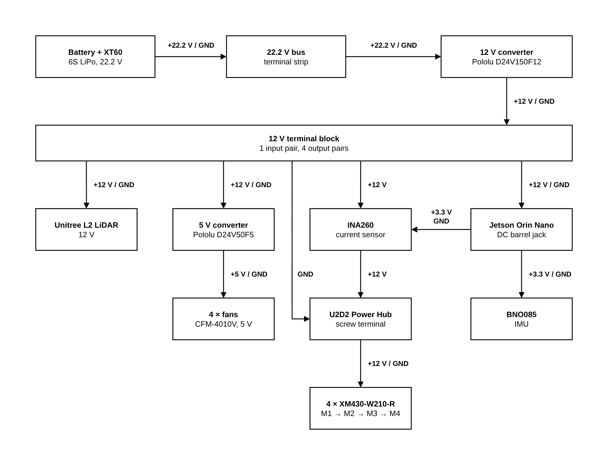
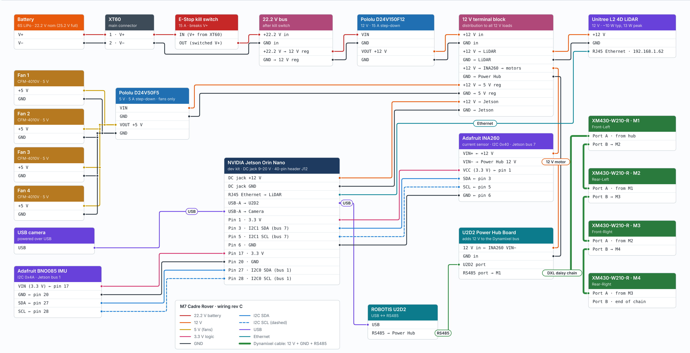
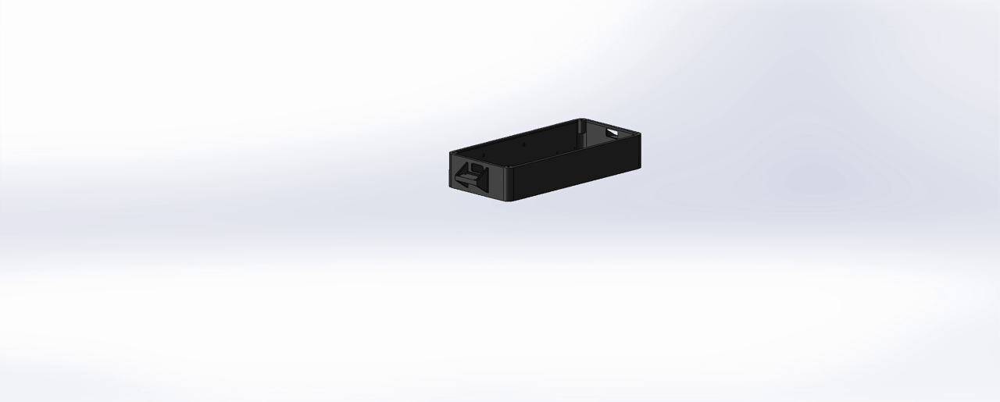
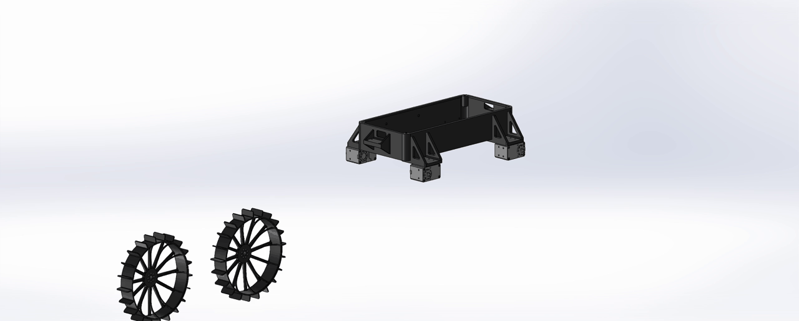
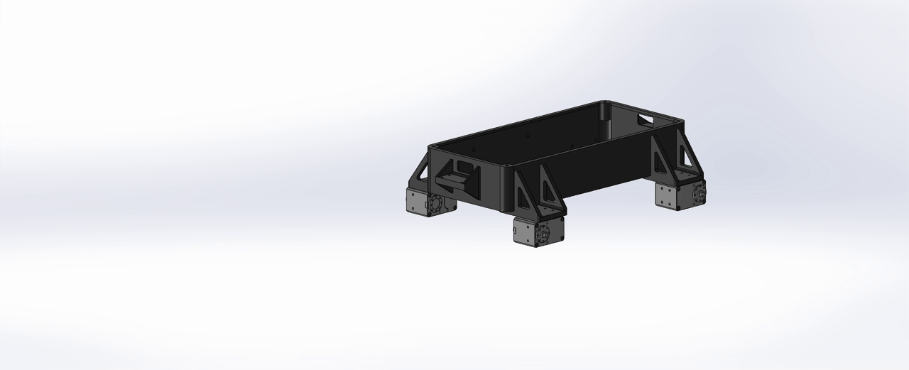
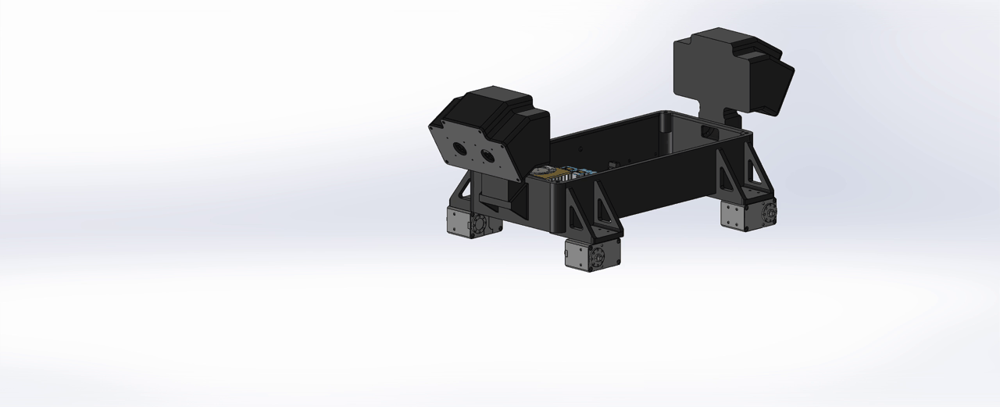
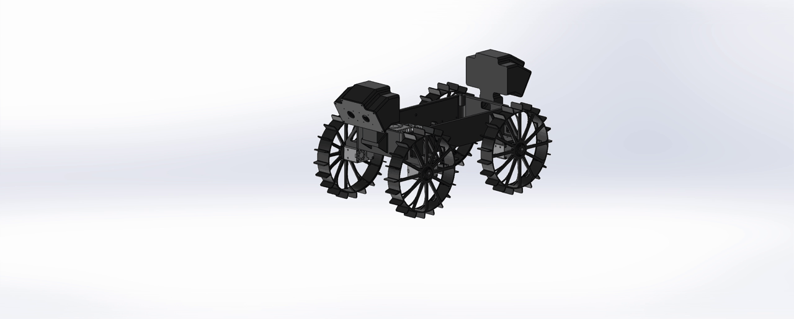

# Assemble the CADRE M7 Rover

Review the electronics and wiring instructions, then follow the six mechanical assembly steps in the order shown.

## Electronics and Wiring

Prepare the wiring below before starting mechanical assembly. Keep the battery disconnected while making connections.

### Power Distribution

The image above shows the simplified power path. Use the Rev C wiring diagram below for the kill switch and individual connections. Its connection numbering differs from the wire labels in the overview.

### Wiring Diagram

### Battery and 12 V Supply

- Prepare the XT60 battery connection for the 6S LiPo battery (22.2 V nominal, 25.2 V fully charged), leaving the battery unplugged.
- Connect the XT60 positive lead to the kill switch input.
- Connect the kill switch output to the positive terminal of the battery-voltage bus.
- Connect the XT60 negative lead to the bus ground terminal.
- Connect the bus positive and ground terminals to VIN and GND on the Pololu D24V150F12 converter.
- Connect the converter's 12 V output and GND to the input pair of the 12 V terminal block.

### 12 V Devices

- Connect one 12 V output pair from the terminal block to the Unitree L2 LiDAR power input and GND.
- Connect another output pair to the Jetson Orin Nano DC barrel jack, matching the jack polarity.
- Connect the motor branch's positive terminal to INA260 VIN+.
- Connect INA260 VIN- to the U2D2 Power Hub's 12 V input.
- Connect the terminal block ground directly to the Power Hub GND. INA260 VIN- is the motor supply output, not ground.
- Connect the remaining 12 V output pair to VIN and GND on the Pololu D24V50F5 converter.

### Cooling Fans

- Connect the Pololu D24V50F5 5 V output to the positive lead of each of the four CFM-4010V fans.
- Connect all four fan ground leads to the converter GND, wiring the fans in parallel.
- Use this 5 V supply for the fans only.

### Motors and U2D2

- Connect a Jetson USB port to the ROBOTIS U2D2 USB port.
- Connect the U2D2 RS485 port to the U2D2 port on the Power Hub.
- Connect the Power Hub RS485 output to motor M1 (front-left).
- Connect M1 to M2 (rear-left), M2 to M3 (front-right), and M3 to M4 (rear-right) using the Dynamixel cables.
- Leave the final unused port on M4 unconnected.

### INA260 Current Sensor to Jetson

- Connect the INA260 to the Jetson 40-pin header using the physical pin numbers below.
- Keep the INA260 3.3 V logic supply separate from its 12 V current-measurement terminals.

| INA260 pin | Jetson physical pin | Function |
| --- | --- | --- |
| VCC | 1 | 3.3 V |
| SDA | 3 | I2C1 SDA |
| SCL | 5 | I2C1 SCL |
| GND | 6 | Ground |

### BNO085 IMU to Jetson

- Connect the BNO085 to the Jetson 40-pin header using the physical pin numbers below.

| BNO085 pin | Jetson physical pin | Function |
| --- | --- | --- |
| VIN | 17 | 3.3 V |
| GND | 20 | Ground |
| SDA | 27 | I2C0 SDA |
| SCL | 28 | I2C0 SCL |

### LiDAR and Cameras

- Connect the Unitree L2 LiDAR Ethernet port to the Jetson Ethernet port.
- Set the Jetson Ethernet interface to the static address `192.168.1.2/24` for the Rev C configuration. The LiDAR address is `192.168.1.62`.
- Connect each RealSense camera to the Jetson using its USB cable.
- Plug the USB cable into each camera and route it into the chassis before seating and fastening its camera mast.

### Before Powering On

- Check connector polarity, terminal tightness, and the wiring against the Rev C diagram.
- Resolve the Rev C review items before first power-up: select a battery fuse to suit the wiring, and address motor-induced voltage dips on the shared Jetson supply.
- Verify the converter outputs are 12 V and 5 V with the loads disconnected, then disconnect power before attaching the loads.
- Remember that the main kill switch cuts power to the Jetson as well as the motors.

### Sensor Check

After mounting the electronics and completing the wiring, power the rover and check the sensors using the Rev C bus assignments:

- Check the INA260 on bus 7 at address `0x40` with `sudo i2cdetect -y -r 7`.
- Check the BNO085 on bus 1 at address `0x4A` with `sudo i2cdetect -y -r 1`.
- Configure the BNO085 software node to use bus 1.

---

## Step-by-Step Assembly Instructions

### Prepare the Parts

- Remove support material from the printed parts and clear the mounting holes.
- Install M2.5 heat-set inserts in the designated insert holes in the chassis and camera masts before assembly.
- Lay out the four motors, four motor brackets, chassis, electronics, two camera masts, top cover, and four wheels.
- Keep power disconnected during assembly.

### Step 1 - Motor Brackets

- Position one motor beneath each motor bracket, matching the orientation shown in the video.
- Seat each motor against its bracket and align the mounting holes.
- Fasten each motor to its bracket using 4 M2.5 x 8mm screws.
- Repeat for all four motors.

### Step 2 - Mounts to Chassis

- Place the chassis with the open compartment facing up.
- Position one motor-and-bracket assembly at each corner of the chassis.
- Orient the triangular braces upward against the chassis and the wheel attachment faces outward.
- Align the bracket mounting holes with the chassis attachment points.
- Fasten each mount to the chassis using 4 M2.5 x 15mm screws.

### Step 3 - Electronics

- Position the electronics assembly above the open chassis, matching the board orientation to the mounting holes.
- Lower the electronics into the chassis and align the mounting holes with their supports.
- Secure the electronic circuit boards and sensors using one M2.5 x 6mm screw in each mounting hole.
- Keep the wiring accessible for the camera mast installation.

### Step 4 - Camera Masts

- Position the first camera mast at one end of the chassis, with the camera openings facing outward.
- Connect the USB cable to the RealSense camera and route it into the chassis before seating and fastening the mast, keeping the cable clear of the mounting points.
- Align its mounting holes with the chassis mounting position and seat the mast as shown.
- Secure the camera mast using 4 M2.5 x 15mm screws.
- Mount the mast cover and fasten it using 6 M2.5 x 6mm screws.
- Repeat for the second camera mast at the opposite end.
- Complete and check the wiring before fitting the top cover. Wiring connections are not shown in these videos.

### Step 5 - Top Cover

- Position the top cover above the chassis, matching the cutouts to the components below.
- Keep cables clear of the cover edges and mounting points.
- Lower the cover between the two camera masts until it sits flush on the chassis.
- Fasten the top cover using 4 M2.5 x 8mm screws at each corner (16 screws total).

### Step 6 - Wheels

- Position the first pair of wheels on the side shown in the video.
- Align each wheel hub with its motor output and seat the wheel on its attachment point.
- Secure each wheel using 8 M2 x 15mm screws.
- Repeat for the remaining two wheels on the opposite side of the chassis.
- Check that all four wheels clear their mounts and the chassis.
- Check that the motor brackets, camera masts, top cover, and wheels are secure.

---
