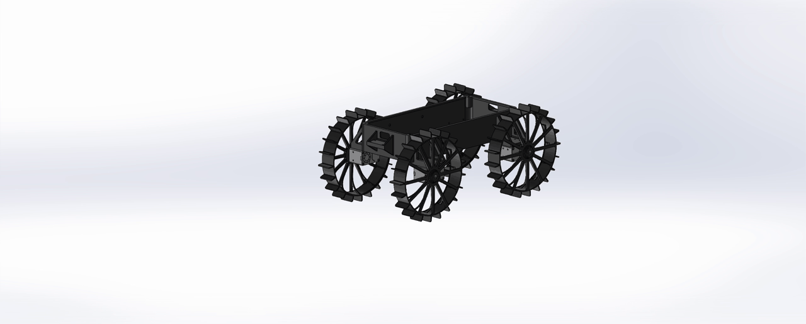

# Assemble the CADRE M7 Rover

Follow the six steps below in the same order as the updated assembly videos.

## Step-by-Step Assembly Instructions

### Prepare the Parts

- Remove support material from the printed parts and clear the mounting holes.
- Install M2.5 heat-set inserts in the designated insert holes in the chassis and camera masts before assembly.
- Lay out the four motors, four motor brackets, chassis, electronics, two camera masts, top cover, and four wheels.
- Keep power disconnected during assembly.

### Step 1 - Motor Brackets

- Position one motor beneath each motor bracket, matching the orientation shown in the video.
- Seat each motor against its bracket and align the mounting holes.
- Fasten each motor to its bracket using 4 M2.5 x 8mm screws.
- Repeat for all four motors.

### Step 2 - Mounts to Chassis

- Place the chassis with the open compartment facing up.
- Position one motor-and-bracket assembly at each corner of the chassis.
- Orient the triangular braces upward against the chassis and the wheel attachment faces outward.
- Align the bracket mounting holes with the chassis attachment points.
- Fasten each mount to the chassis using 4 M2.5 x 15mm screws.

### Step 3 - Electronics

- Position the electronics assembly above the open chassis, matching the board orientation(mounting holes).
- Lower the electronics into the chassis and align the mounting holes with their supports.
- Secure the electronic circuit boards and sensors using one M2.5 x 6mm screw in each mounting hole.
- Keep the wiring accessible for the camera mast installation.

### Step 4 - Camera Masts

- Position the first camera mast at one end of the chassis, with the camera openings facing outward.
- Connect the USB cable to the RealSense camera and route it into the chassis before seating and fastening the mast, keeping the cable clear of the mounting points.
- Align its mounting with the chassis mounting position and seat the mast as shown.
- Secure the camera mast using 4 M2.5 x 15mm screws.
- Mount the Mast cover and fasten it using 6 M2.5 x 6mm srews.
- Repeat for the second camera mast at the opposite end.
- Complete and check the wiring before fitting the top cover. Wiring connections are not shown in these videos.

### Step 5 - Top Cover

- Position the top cover above the chassis, matching the cutouts to the components below.
- Keep cables clear of the cover edges and mounting points.
- Lower the cover between the two camera masts until it sits flush on the chassis.
- Fasten the top cover using 4 M2.5 x 8mm screws at each corner (16 screws total).

### Step 6 - Wheels

- Position the first pair of wheels on the side shown in the video.
- Align each wheel hub with its motor output and seat the wheel on its attachment point.
- Secure each wheel using 8 M2 x 15mm screws.
- Repeat for the remaining two wheels on the opposite side of the chassis.
- Check that all four wheels clear their mounts and the chassis.
- Check that the motor brackets, camera masts, top cover, and wheels are secure.

---

